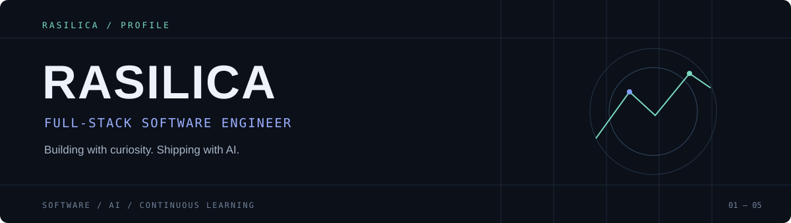

  

### 01 / ABOUT

I'm a **full-stack software engineer at an early-stage startup**, building across the stack and using AI as a partner in development.

I enjoy turning ideas into working software: exploring a problem, building a practical solution, and improving it through testing and iteration.

`FULL-STACK` &nbsp; `AI-ASSISTED DEVELOPMENT` &nbsp; `BUILD & LEARN`

---

### 02 / FEATURED PROJECT

#### [Hybrid AI News Neutrality Analysis](https://github.com/Rasilica/neutrality-project)

A news analysis platform that combines cloud and local language models to analyze articles and comments. The project includes an AI analysis engine, an API server, and a dashboard.

`Python` · `FastAPI` · `Java` · `Spring Boot` · `PostgreSQL` · `Docker`

[Explore the project →](https://github.com/Rasilica/neutrality-project)

---

### 03 / TECHNOLOGIES

Technologies I've explored in projects and learning:

---

### 04 / CONNECT

[GitHub](https://github.com/Rasilica) · [Email](mailto:rasilica@zohomail.com)

   
  Curious about ideas. Focused on building.

